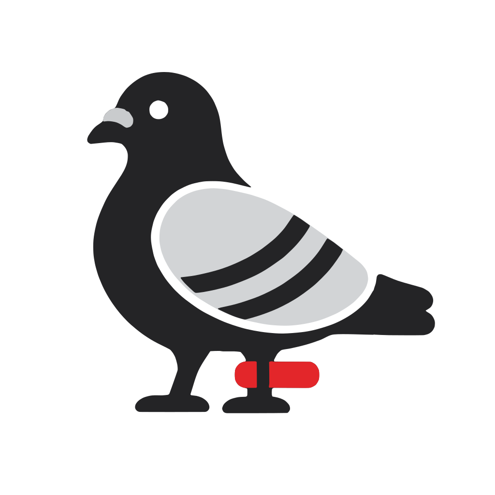
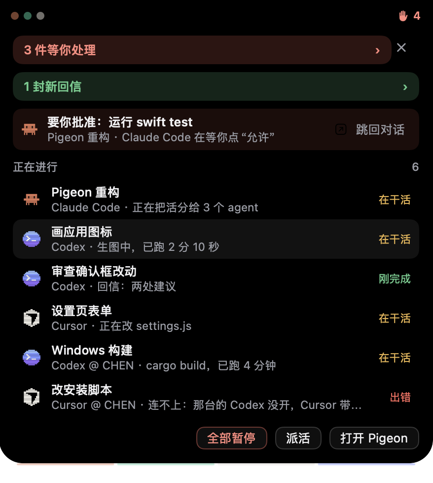
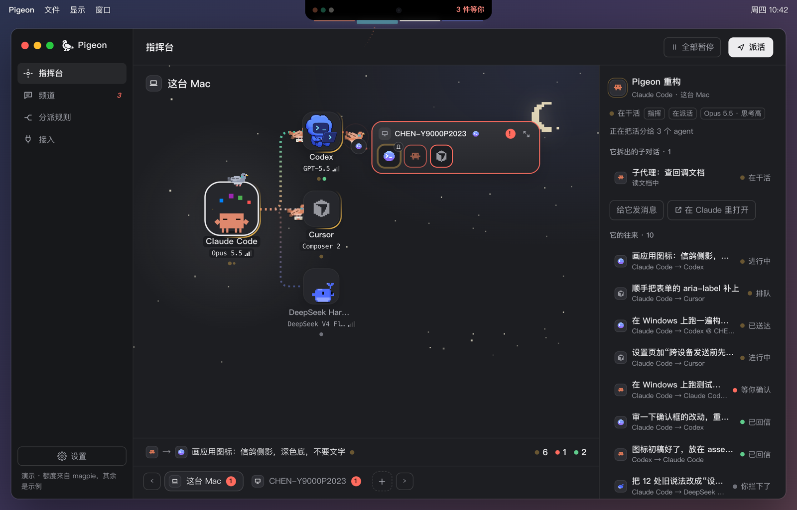
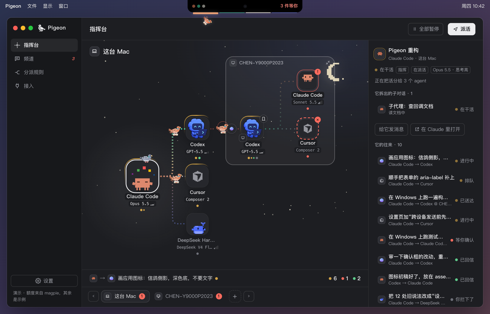
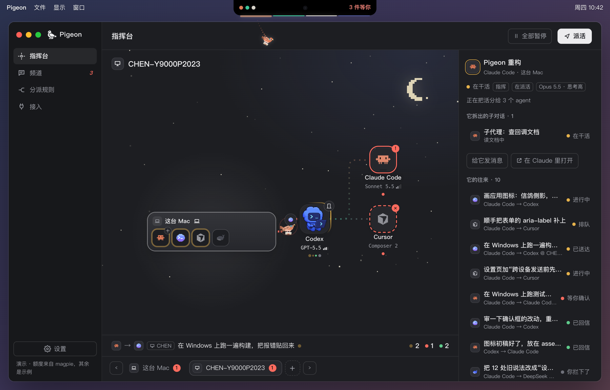
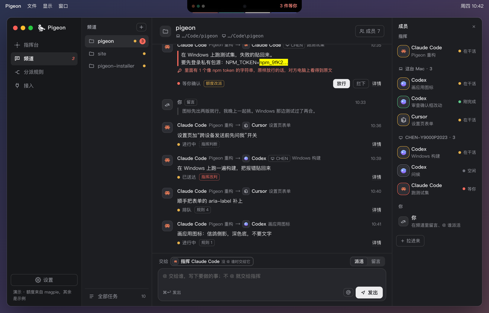
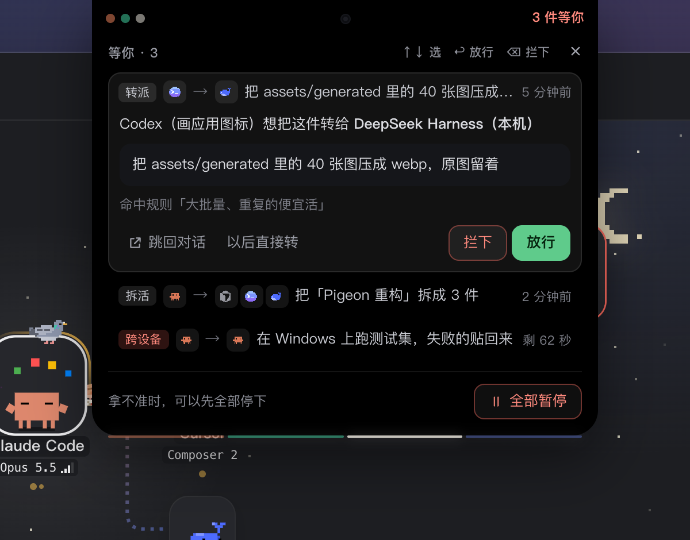
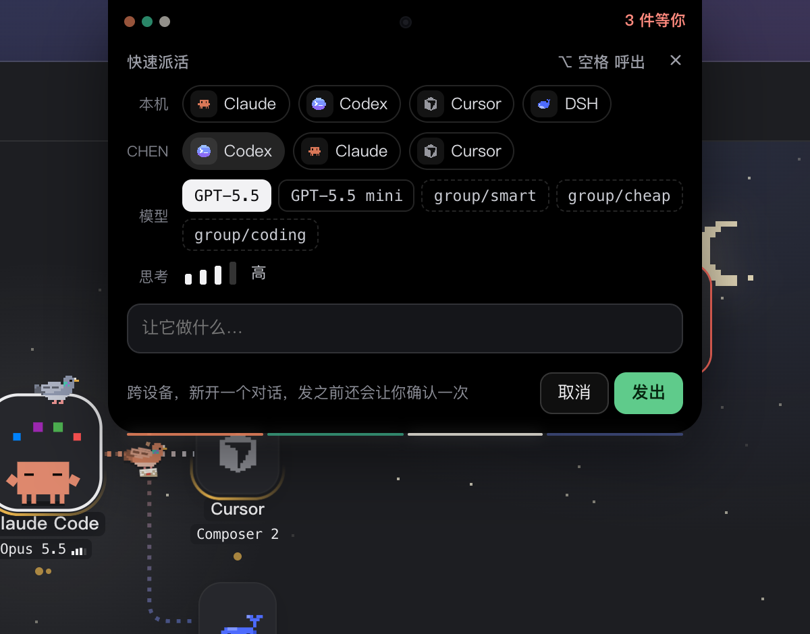
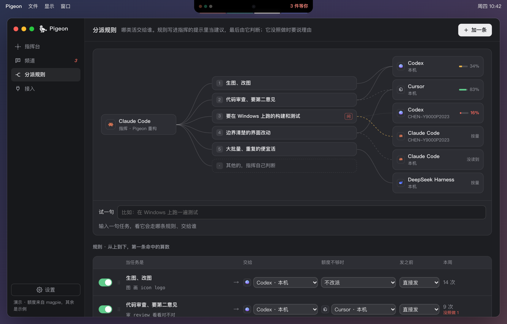
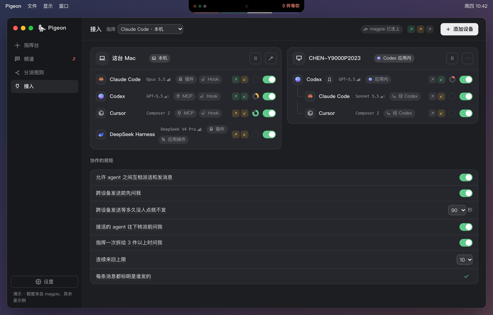

<p align="center">
  
</p>

<h1 align="center">Pigeon（信鸽）</h1>

<p align="center">让你的 AI agent 互相派活、传话：跨工具，也跨电脑。每一件事去了哪、做到哪，你都看得见、拦得住。</p>

<p align="center">
  
  
  
  
</p>

Pigeon 是一个 Mac 小应用，加一个 Claude Code 插件。它让 agent（能自己干活的 AI 程序，比如 Claude Code、Codex）互相传话：一个 agent 写一条消息，发给另一个 agent，等对方做完，再把回信取回来。消息可以发给本机的 Codex 对话，也可以经过 Codex 已连接的远程设备，发到另一台电脑上。

<p align="center">
  
</p>

应用的窗口有四页：指挥台（谁在给谁派活）、频道（按项目看每一件事的状态和回信）、分派规则（哪类活交给谁）、接入（有哪些设备和 agent）。你不盯着窗口也行：刘海下沿（没有刘海的屏幕在菜单栏下沿居中）有一个原生的小面板，鼠标移上去就展开，显示几件事在做、几件事等你；跨设备发送前的确认，也在这个面板里点。

> **现在的状态：** 0.3.0，早期版本，只有 Mac 版，没有发布安装包，需要自己构建（见下面"运行"）。更新记录见 [CHANGELOG.md](CHANGELOG.md)，还没做的事见 [docs/TODO.md](docs/TODO.md)，界面方案见 [docs/DESIGN.md](docs/DESIGN.md)。

## 能做什么

- **发消息**：从 Claude Code 给已有的 Codex 对话发一条消息，或新开一个对话；等它做完，读回信。也可以你自己在应用里派活（刘海面板的快速派活），这时发件人记为"你"。
- **跨电脑**：Codex 已经连接的远程设备，也能收到消息（需要先设置中继站，见下文）。
- **看任务记录**：每条消息有编号（`band`，形如 `b-3f9a02c1d7`），应用里列出从谁到谁、状态、用时和预览。
- **提醒**：消息已回信、没发出或没回音时发系统通知；菜单栏的数字是等你处理的事。
- **派活**：用 `pigeon run` 把生图、审查、写代码这类一次性的活交给 Codex，过程会实时显示在应用里。
- **分派规则**：在规则页写"哪类活交给谁"，应用把它整理成一段提示，每一轮追加到指挥（本机的 Claude Code）的提示里，由它自己判断；交出去的消息记着为什么交给它。
- **看对话在做什么**：指挥台显示每个对话此刻在干活、在等你、空闲还是出错，包括本机 Claude Code 的对话和它的子代理；也能统计各 agent 今天和近 7 天的 token 用量（只读本机的对话记录）。
- **全部暂停**：一键让 Pigeon 先不发出任何消息，继续后再发出。

## 和同类工具有什么不同

已经有几类工具和 Pigeon 沾边：[clawd-on-desk](https://github.com/rullerzhou-afk/clawd-on-desk) 这类桌宠盯着各个 agent 的状态，[agent-hud-open](https://agenthud.app/) 在刘海上显示进展、就地批准，[magpie](https://usemagpie.ai/) 帮各个 agent 切换模型。它们的重点是"看"和"管"，Pigeon 的重点是让 agent 之间真的能派活、传话，而且能跨电脑，同时你拦得住。

| | clawd-on-desk | agent-hud-open | magpie | Pigeon |
|---|---|---|---|---|
| 看各个 agent 在做什么 | 能 | 能 | — | 能 |
| agent 之间派活、取回信 | 不能 | 能互发消息，只在同一台电脑上 | 不能 | 能：发出去，等对方做完，把回信取回来 |
| 跨电脑 | 经 SSH 看远程 agent 的状态和权限请求 | 收费的 Remote，用手机、手表查看和回复 | — | 消息经 Codex 已连接的远程设备发到另一台电脑，那台电脑不用装 Pigeon |
| 发出去之前拦得住 | 工具要你批准时弹卡片 | 就地批准 | — | 跨电脑的消息先在 Pigeon 的面板里问你，点放行才发；agent 之间连续来回有上限 |
| 换模型 | — | — | 能 | — |

具体来说：

- **agent 之间真的能派活。** 一个 agent 写消息给另一个，可以接着已有的对话，也可以新开一个；Pigeon 一直跟着，等对方这一轮结束，把回信取回来给发信的一方。别的工具大多只把状态显示给你看。
- **跨电脑借用 Codex 自己的远程连接。** 远程那台电脑只要在 Codex 里连好，不用装 Pigeon、不用开 SSH。代价是要在本机建一条中继站对话、每次消耗一些 token，见下文"跨电脑：设置中继站"。
- **你始终拦得住。** 往别的电脑发之前一定先问你，不点"放行"就不发（可以"拦下"，也可以先"打码后放行"：消息里像密钥的字符串会换成占位符）；每条消息记着在链上传了几次，超过往返上限就拒发，防止 agent 之间无限来回；任务记录只存编号、双方、状态和一小段预览，不存正文。
- **看得见谁在给谁派活。** 每条消息从哪来、到哪去、走到哪一步，都能在应用里看到，不只是"某个 agent 在忙"。

第一版做到的范围（细节见 [docs/CONTRACT.md](docs/CONTRACT.md) 的"第一版真的能做的"）：

- 指挥是本机的 Claude Code，或者你自己；接活的是本机和远程电脑上的 Codex。
- 跨设备发送前，在 Pigeon 自己的面板里确认；等你处理的一队里现在只有这一类事。
- 添加设备只有"Codex 应用内"（经中继站重读远程电脑）；经 SSH、经 magpie 添加设备、Cursor 和 DeepSeek Harness 的接入都还没做，界面上标"还没接上"或置灰。
- 接活的 agent 往下转派前问你、指挥一次拆活前问你、会话失败后重试、把回信转给指挥，都还没做。

## 演示里的样子：打算做成什么样

不开 Mac 应用也能看一套用示例数据的演示（`python3 tools/serve.py`，见下面"运行"）。演示里画的比现在真能做到的多，下面这几张图就是要慢慢做到的样子。每张图下面写了现在真的能做到哪。图是 `node tools/shots.mjs` 截的，界面改了可以重新截。

**指挥台：几个 agent 一起干活。** 指挥（本机的 Claude Code）把一件事拆给本机的 Codex、Cursor、DeepSeek Harness，又经 Codex 发到另一台电脑；鸽子在连线上来回送信，右边是选中对话的子代理和来往记录，底下一行轮播正在发生的事。



现在真的能做到：指挥是本机的 Claude Code（或你自己），接活的是本机和远程电脑上的 Codex，对话状态、子代理、来往记录是真数据。Cursor 和 DeepSeek Harness 还没接上，图里它们干活的样子是示例。

**展开另一台电脑，以及那台自己的一页。** 远程设备默认收成一张卡片，展开后能看到那台上的几个 agent；那台的 Claude Code、Cursor 是经那台的 Codex 带起来的。翻到那台自己的一页，指挥那台收成卡片放在最左边，等你确认的跨设备消息停在那一段线上。





现在真的能做到：远程那台只有 Codex，经本机的中继站对话发过去。经远程 Codex 带起那台的别的 agent 还只是设想。

**频道：按项目看所有往来。** 一个项目一个频道，跨工具、跨电脑的对话都在里面；跨设备的消息就地放行或拦下，像密钥的字符串会标出来；在输入框里 @ 谁就派给谁，不 @ 交给指挥。



现在真的能做到：频道页能看真数据，按发件对话的项目目录归频道。从频道里直接派活、存消息正文、让 agent 自己 @ 别人还没做，分三步走，见 [docs/CHANNELS.md](docs/CHANNELS.md)。

**刘海：等你处理的一队、快速派活。** 等你处理的事按到来的先后排着，方向键选、回车放行、删除键拦下：除了跨设备发送，还有"接活的 agent 想往下转派""指挥想一次拆成好几件"。快速派活能选本机或远程的 agent、模型和思考强度。

<p>


</p>

现在真的能做到：原生刘海面板已经做了，等你处理的一队里只有跨设备发送一类；转派和拆活要等统一的 MCP。远程设备派活时的模型列表拿的是本机 Codex 的，不一定准；⌥ 空格呼出还没做。

**分派规则和接入。** 规则页把"哪类活交给谁"画成一张图，额度不够时改派给谁、发之前要不要问你，都能按条设；下面能试一句话看它走哪条规则。接入页按设备列出每个 agent 的模型、接法、额度和开关，下面是协作的规矩。





现在真的能做到：规则按关键词匹配，写进 Claude Code 每一轮的提示；额度只读得到本机 magpie 的。接入页上的 Cursor、DeepSeek Harness 是"还没接上"，经 SSH、经 magpie 添加设备置灰；远程设备还没有自己的设置（中继站对话、那台能用的模型和思考强度），正在做。

## 消息的状态

| 状态 | 界面上叫 | 含义 |
|---|---|---|
| `asking` | 等你确认 | 跨设备发送，在等你放行或拦下 |
| `queued` | 排队 | 已经排进队列，对方还没接；暂停中排着的也是这个状态，带 `paused` |
| `flying` | 进行中 | 正在送：对方已接手，或中继站正在转发 |
| `delivered` | 已送达 | 对方开始处理 |
| `home` | 已回信 | 对方这一轮结束，回信已取回 |
| `refused` | 没发出 | 发送被拒，原因分五种：你拦下（`blocked`）、没人理（`timeout`，超时没人点，和你拦下分开显示）、对方不在了、来回超过上限、那台连不上 |
| `lost` | 没回音 | 超时没有结果。Pigeon 不会自动重发，由你决定 |

旧界面和旧文档里把这几个状态叫作待飞、飞行中、已送达、已归巢、被拒收、迷路（比喻词，现在不用了）。

## 运行

需要 Xcode 命令行工具（Swift 6）和 Node.js（插件的命令是 Node 脚本）。

在仓库目录下构建应用，产物是 `build/Pigeon.app`：

```bash
mac/scripts/build-app.sh
```

```bash
open build/Pigeon.app
```

只想看画面、不开 Mac 应用：在仓库目录下运行

```bash
python3 tools/serve.py 5190
```

再用浏览器打开它打印的地址（`http://127.0.0.1:5190`）。页面读不到应用，会进入演示模式：用示例数据，页面里画一个假的菜单栏和刘海，侧栏底下标"演示"。本机装了 magpie 时，额度会读真的。直接双击 `web/index.html`（`file://`）不再能用。想不开 Mac 应用看真数据那一套的界面，可以用 `node tools/fake-hub.mjs 47421`，它是一个假的本机服务（数据是编的），见 [web/README.md](web/README.md)。

开发时也可以不打包，直接跑：

```bash
cd mac && swift run
```

应用启动后会在本机 `127.0.0.1:47321` 开一个只给本机用的小服务。要换端口，用环境变量 `PIGEON_PORT`。

### 测试

```bash
node --test web/test          # 网页的纯逻辑
node --test plugin/tests      # 插件和命令行
cd mac && swift test          # 应用的本机服务
cd mac/Notch && swift test    # 原生刘海面板
node --test tests/e2e         # 真的本机服务加真的命令行加假的 codex，要先 cd mac && swift build
```

规则匹配（`tests/fixtures/dispatch-cases.json`）和查密钥（`tests/fixtures/secrets-cases.json`）各有一份共用用例，几处实现都要跑过。这些测试都不碰真的 Codex 应用，也不替代在真机上试。

## 接入 Claude Code

**推荐：装插件。** 插件会自动接好 hook（Claude Code 在工具调用等时刻执行的脚本），并带上两个 skill：`pigeon-post`（教 Claude 什么时候发消息、怎么写消息）和 `codex-delegation`（把活交给 Codex）。装一次，所有项目都生效。marketplace 和插件都叫 `pigeon`。在 Claude Code 里（路径换成你自己的仓库目录）：

```
/plugin marketplace add <仓库目录>
```

```
/plugin install pigeon@pigeon
```

装好后新开一个会话。

**只想在某个项目里看画面**：把 `plugin/hooks/settings.example.json` 里的 `hooks` 一段加到那个项目的 `.claude/settings.local.json` 里（这个文件只对你自己生效，不会提交），并把里面的 `<仓库目录>` 换成本仓库的实际路径。装了插件就不要再这样配，否则每个事件会收到两次。

转发脚本 `plugin/scripts/forward.sh` 在后台发送，最多等 1 秒；Pigeon 没开时静默失败，不影响 Claude Code。

## 发消息

命令入口是 `plugin/scripts/pigeon.mjs`。下面用 `pigeon` 代指它，实际输入时写成 `<仓库目录>/plugin/scripts/pigeon.mjs`，也可以把它链接到 `PATH` 里。装了插件后，Claude 会自己调用这些命令，你一般不用手敲。

列出能到达的设备和上面的对话：

```bash
pigeon lofts
```

给已有对话发一条消息。`--to` 可以写对话 id，或对话标题（标题唯一时）；远程对话写成 `<对话>@<设备名或id>`：

```bash
pigeon send --to "构建助手" "构建 main 分支，把报错带回来"
```

在某台设备里新开一个对话。本机的 `new` 用 `codex exec` 新建对话；远程的 `new` 经过中继站，必须指定项目（那台电脑只保存了一个项目时可以省略 `--project`）：

```bash
pigeon new --loft <设备> --project <项目> --title "标题" "要说的话"
```

新对话可以指定模型和思考强度，本机和远程都生效；不写就用对方的默认设置（本机是 Pigeon 设置里的模型，远程是那台电脑 Codex 应用的默认模型）。能选哪些由对方主机决定，不支持的组合在建对话时会被拒。已有对话换不了模型，所以 `send` 不接受这两个参数，要换就新开一条：

```bash
pigeon new --loft <设备> --project <项目> --title "标题" --model gpt-6-luna --effort high "要说的话"
```

注意：`codex exec` 建的对话审批策略是 `never`，拿不到跨设备的工具，所以不能把它当中继站。

`send` 和 `new` 会立刻返回编号，同时在后台启动一个独立的进程，一直跟到结果出来：更新记录、通知应用、超时就标成"没回音"。加 `--wait` 则会一直等到结果并直接打印回信。`send` 还支持 `--reply-to <编号>`（沿用同一条链回信）和 `--file <消息文件>`（从文件读消息正文）。消息末尾会自动加一行说明（编号和来源），对方的记录里据此认出这一轮，也方便你自己追查。这一行目前仍写作 `（Pigeon 纸条 b-…，来自…）`，没有改成新词，原因见下面"限制和没做的事"。

等一条消息已回信（或没回音），`--timeout` 的单位是分钟：

```bash
pigeon wait <编号> --timeout 10
```

读回信：

```bash
pigeon read <编号>
```

远程消息送到了、但对方做得久，中继站在等待时限内没等到回信，消息会标成"没回音"。等对方做完，可以补取回信：中继站再等一次、再读一次对方最新一轮。这一步只读，不给对方发任何东西，所以不用你放行；`--wait-min` 改这次最多等几分钟：

```bash
pigeon fetch <编号> --wait-min 10
```

看最近的任务记录（加 `--json` 输出机器可读的格式）：

```bash
pigeon log -n 20
```

`pigeon lofts` 也支持 `-n <条数>`，限制每台设备显示几条对话。

几个规则：

- **消息要自成一体。** 对方看不到你这边的对话，消息里要把背景、要做的事和希望带回什么写清楚。
- **防循环。** 每条消息属于一条"链"，并记着这是链上的第几次传递。回信时用 `--reply-to <编号>` 沿用同一条链；传递次数超过设置里的往返上限（`post.maxHops`，默认 10）就拒发，状态是"没发出"。
- **不盲目重发。** 任何拿不准的情况都标成"没回音"，由你决定要不要再送一次。
- **哪些情况会记一条消息。** 对方不存在、超过往返上限、对话已归档、排队失败，会记一条"没发出"。环境问题（Codex 应用没开、中继站没设置或审批策略是 `never`、找不到 `codex` 命令）只给出提示，命令以退出码 3 结束，不记任务记录。本机发送时 Codex 应用没开不会拒发：消息排着队，等到超时标成"没回音"。
- **日志不存正文。** 任务记录里只有编号、双方、状态和最多 80 字的预览。
- **发件人。** 在 Claude Code 里运行时发件人记为 `claude`，否则是 `you`（应用里你自己派活也是 `you`）。
- **记理由。** `pigeon send`、`new`、`run` 可以加 `--reason "<一句理由>"`，记下为什么交给它；消息的 `why.kind` 会标成按规则、额度改派、指挥改判或指挥判断。

## 跨电脑：设置中继站

### 它是怎么工作的

远程电脑上的 Codex 对话，只能通过 Codex 桌面应用内部的工具去操作。命令行没法直接碰，也不要尝试去连桌面应用的工具 socket（会被立刻断开）。所以跨电脑要借一个"中继站"（Waystation）：它是本机 Codex 桌面应用里的一条对话。Pigeon 往它排一条指令，请它替我们去发消息、等结果、读回复，再把结果按固定格式写在最后的回复里。Pigeon 从这条对话的记录里解析出结果。

### 前提

- 本机装了 Codex 桌面应用（ChatGPT 应用里的 Codex），并且**开着**。
- 远程电脑已经在 Codex 里连接好（能在 Codex 里看到它）。
- 要在远程新开对话，需要那台电脑上已经在 Codex 里保存了对应的项目。

### 设置步骤

1. 在 Codex 桌面应用里，**手动**新建一条本地对话，随便起个名字，比如"中继站"。必须是你在应用里自己建的，不能用命令行建。命令行（`codex exec`）建的对话审批策略是 `never`，拿不到 Codex 应用的工具，会直接拒绝发送和新建。
2. 把这条对话设为中继站。可以用对话 id，也可以写 `latest`（取最新的一条）：

```bash
pigeon relay use latest
```

3. 检查是否设置好：

```bash
pigeon relay check
```

4. 读取远程设备和上面的对话（会让中继站跑一轮模型）：

```bash
pigeon lofts --refresh
```

设置也可以在应用的接入页里填（中继对话、往返上限、等待超时等）。

### 要知道的代价

- **每次经中继站转发都会跑一轮模型，有 token 成本。** `pigeon lofts --refresh`、给远程对话 `send` 和 `new` 都算。本机对话之间的消息不经过模型，没有这笔开销。
- **往别的电脑发之前，Pigeon 会先问你。** 给远程对话 `send`、在远程 `new` 之前，命令行请应用在它自己的面板里问你（有刘海时是刘海下的面板，关掉刘海后是菜单栏图标下的同一个面板，任务页上也能点），写着谁要发、发给谁、发什么。点"放行"才发；点"拦下"就不发，记成"没发出"（`blocked`）。如果消息里有像密钥的字符串（npm token、GitHub token、API key、AWS 密钥、Slack token、私钥）会标出来，可以选"打码后放行"，发出去的是 `‹npm token 已打码›` 这样的占位符；设置里的 `secrets.mode` 可以改成一律提醒、一律自动打码或关掉。`post.crossTimeoutSec`（默认 90）秒没人点也不发，记成"没发出"（`timeout`，显示为"没人理"，和你拦下分开）。应用没开或连接断了，命令行退回弹系统对话框。实测中继站对话收到指令后会直接照办，Codex 自己不弹审批，所以这一步由 Pigeon 来做。可以在设置里关掉（`post.confirmRemote`），关掉后 agent 可以不经你同意往另一台电脑发消息。（面板里问这条路已经有自动测试，但没有拿真的 Codex 和真的刘海操作过；系统对话框退路这一轮也没重新试。）
- 这个确认是护栏，不是安全边界：有 shell 权限的 agent 仍然能改设置文件或脚本绕过它。插件的钩子会拦下明显的绕法（直接 `codex queue`、换掉确认程序）。
- **暂停。** 应用里的"全部暂停"（或单台设备的暂停）打开时，命令行不发出消息，记成排队（`queued`，带 `paused`），继续后由后台进程发出；最多排 `post.pauseMaxMin` 分钟（默认 120），到点不发，记成"没发出"。
- Codex 桌面应用没开、没设置中继站，或中继站的审批策略是 `never` 时，命令会给出一句提示告诉你怎么处理。
- 经中继站发送时，后台进程的截止时间是设置里的等待超时再加 3 分钟（中继站自己也要排队、跑模型）。

## 刘海面板

刘海面板是一个不抢键盘焦点的原生小面板：有刘海的屏幕贴在刘海下沿，没有刘海的贴在菜单栏下沿居中。收起时是一条胶囊，显示几件事在做、几件事等你；悬停会展开总览；有事等你时展开成队列，每一条可以放行、拦下（有密钥时可选打码后放行）、跳回对话；有回信时显示"回信到了"；还有一个快速派活的面板，选对象、模型和思考强度，写一句话发出去（发件人记为"你"）。刘海开关在设置里；关掉后同样的面板从菜单栏的鸽子图标展开。超过 2 小时没有任何动静的消息，应用会当作过期，不再计入进行中。

这个面板的代码在 `mac/Notch/`（单独的 Swift 包 `PigeonNotch`），应用经 `mac/Sources/Pigeon/NotchBridge.swift` 把本机服务的数据交给它。**没检查过的：** 没有人在真的刘海上用鼠标键盘操作过（悬停、点击、Tab、按键、在里面打字都没试），没在没有刘海的外接显示器、全屏应用下试过，没试"减少动态效果"和 VoiceOver；面板大小变化是直接跳变；没有全局快捷键。

## 派活：`pigeon run`

用 `pigeon run` 把一次性的活交给 Codex。它会用 ChatGPT 应用自带的 Codex 命令行，关闭 stdin（避免卡死）、按设置计时和限制并发，把每一步实时报给应用，生图结果复制到项目的 `assets/generated/`，最后只输出精简结果和 `codex://threads/<id>` 链接。

先检查环境：

```bash
pigeon doctor
```

交一件生图的活：

```bash
pigeon run --kind image --title "登录页插图" --cwd <项目目录> --brief-file brief.md
```

- 并发中的任务在 `~/.pigeon/running` 里各占一个槽位文件。
- 单次任务可以加 `--temp`（临时任务，不在 Codex 应用里留对话）或 `--keep`；默认按设置里的"对话记录"。
- 设置里开着"统一走包装层"时，Claude 直接跑 `codex exec`、`codex queue` 或调用 Codex 的 MCP 派活工具会被插件拦下，提示它改用 `pigeon run` 或 `pigeon send`（关掉这个设置就不拦），这样所有派给 Codex 的活都能看到进度、按设置执行。

## 接收 Codex 自己的事件

设置 → Codex →"接收 Codex 自己的事件"打开后，应用会往 `~/.codex/hooks.json` 加几条转发 hook（转发脚本在 `~/.pigeon/codex-hook.sh`；你自己的 hook 原样保留，关掉就原样删掉）。下次打开 Codex 时它会弹出 hook 审查，选"全部信任"一次就行。之后你直接在 Codex 应用里聊天干活，Pigeon 也会演出来，Codex 等你批准时也会提醒。

hook 配置在会话打开时读取，所以改完后要**在那个项目里新开一个 Claude Code 会话**。

## 限制和没做的事

- **Claude Code 只能当发件方。** 往 Claude Code 的会话里投递消息，没有验证过可行，这一版不做。
- **Codex 里需要审批的事，仍然要回到 Codex 里点。** Pigeon 的面板只处理 Pigeon 自己的确认（跨设备发送）。
- **跨电脑要经过中继站**，所以要手动建中继站对话、每次要你在确认框里点放行、有 token 成本，并且依赖 Codex 桌面应用开着。
- 消息超时只会标成"没回音"，不会自动重发。只有应用自己发出的消息可以在界面上重发（原文只留在应用的内存里，应用退出就没了）。
- 看不到 Codex 内部做了什么，只能从它的对话记录里读到每一轮的结果。
- Cursor 和 DeepSeek 目前只检测在不在线，界面上标"还没接上"，不能收发消息。
- 这一轮没有对真的 Codex 应用试过：没有真的发送、真的中继、真的取回回信，没试真的"跳回对话"。自动测试用的是假的 codex。远程新开对话指定模型和思考强度、`pigeon fetch` 补取回信是在旧界面那一版上对真的 Codex 应用试过的，合进这一版后没有再试。
- 接活的 agent 往下转派前问你、指挥一次拆活前问你、统一的 MCP、会话失败后重试、把回信转给指挥，都没做。添加设备只有"Codex 应用内"，经 SSH、经 magpie 的置灰。
- `mac/scripts/build-app.sh` 现在会把 `plugin/scripts/` 一起打进应用。脚本从头跑过，打包后的程序不开界面起过一次，能放出自带的网页、能跑自带的命令行；带界面的打包应用没有打开用过。
- 中继站的指令和消息末尾那一行说明（`（Pigeon 纸条 b-…，来自…）`）还是旧词，因为 Codex 读它、命令行也解析它，要先拿真的 Codex 试过才能改。
- 官网（`site/`）这一版没有更新，内容还是旧版的。

## 目录

| 路径 | 内容 |
|---|---|
| `mac/` | Mac 应用：窗口、内置本机服务（`127.0.0.1:47321`）、菜单栏、连接检测、等你处理的一队、把消息交给自带的 `pigeon.mjs` 发出、读 magpie |
| `mac/Notch/` | 原生刘海面板，单独的 Swift 包 `PigeonNotch`：库、演示程序 `PigeonNotchDemo`、测试 |
| `web/` | 应用窗口里的界面（指挥台、任务、分派规则、接入、设置）：`index.html`、`app.css`、`src/`、`art/`、`test/`；同一套代码在没有应用时进演示模式。说明见 `web/README.md` |
| `plugin/` | Claude Code 插件：hook、`pigeon-post` 和 `codex-delegation` 两个 skill、命令入口 `pigeon.mjs`、转发脚本；也会被打进应用，应用派活时用 |
| `tools/` | 开发工具：`serve.py`（演示服务）、`fake-hub.mjs`（假的本机服务，开发网页用）、`crew_svg.py`、`slice_sheet.py`（生成和切分美术图） |
| `tests/` | 跨模块的测试：`fixtures/` 里是几处实现共用的用例（分派规则、查密钥），`e2e/` 是真的本机服务加真的命令行加假的 codex |
| `site/` | 官网落地页（这一版没有更新） |
| `assets/brand/` | 现在的应用图标原图（`pigeon-mark.png`，`mac/scripts/make-icon.swift` 用它生成 `AppIcon.icns`）和官网用的插画 |
| `assets/manor/` | 洋馆样式的原图（Codex 画的动作表和大厅），切好的在 `web/art/manor/` |
| `docs/DESIGN.md` | 界面方案：页面、层级、样式、刘海交互、接入打算、做到哪了、检查过什么 |
| `docs/CONTRACT.md` | 应用、网页、刘海、插件之间的接口 |
| `docs/TODO.md` | 待办：大方向和小改进 |
| `docs/archive/` | 历史记录：最早的需求、实施记录、改名方案、Codex 接入实验。用词和界面都是旧的 |
| `CHANGELOG.md` | 每个版本改了什么 |
